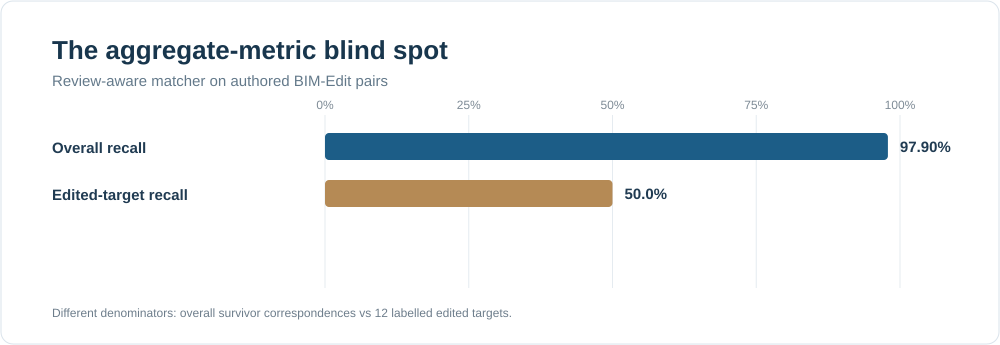
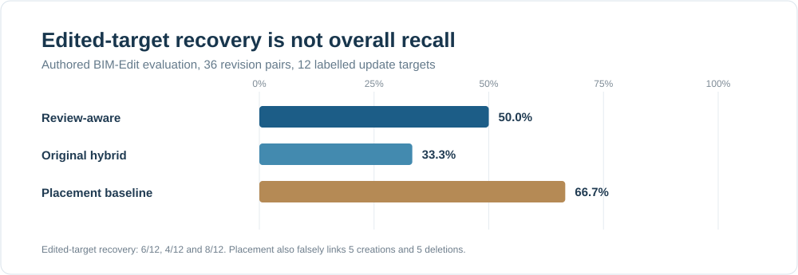
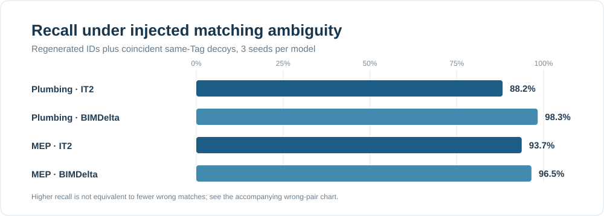
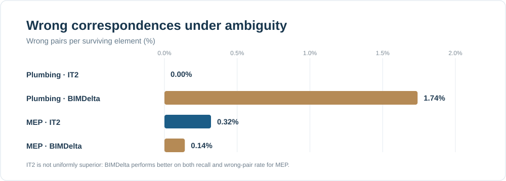
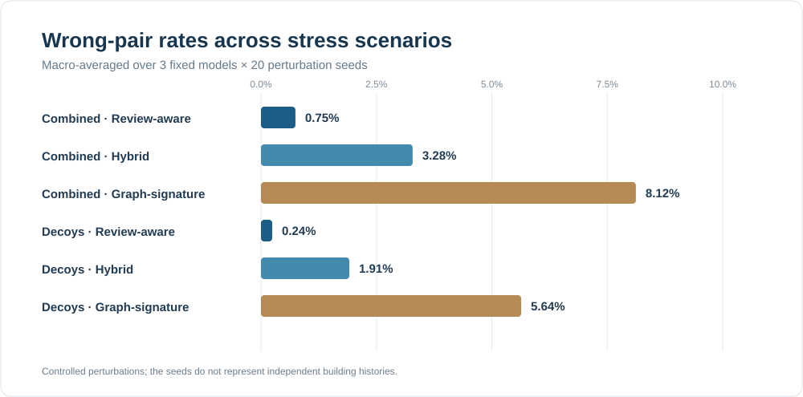
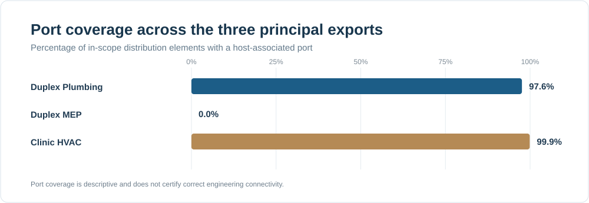

<div align="center">

# IT2 | IFC Revision Integrity

### Empirical Failure Analysis of Asset Correspondence and Network Topology

**Reproducible experiments · Controlled IFC revisions · Review-aware matching · Network adjacency checks**

[](README.md)
[](environment.yml)
[](LICENSE)
[](results/)
[](REPRODUCIBILITY.md)

**[Research question](#research-question) · [Key findings](#key-findings) · [Figures](#visual-results) · [Methods](#methodology) · [Reproduce](#reproduce-the-study) · [Docker](#local-evidence-dashboard) · [Limitations](#scope-and-limitations)**

</div>

---

## Overview

**An IFC revision can appear almost unchanged in aggregate evaluation while the elements that matter most are not recovered, or the exported network has been rewired.**

This repository contains the research code, saved features, reported experimental outputs and supporting documentation for the conference manuscript:

> **Verifying Cross-Revision Referential Integrity in IFC Models: An Empirical Failure Analysis of Asset Correspondence and Network Topology**

IT2 examines two narrow **IFC-side** prerequisites for reliable cross-revision references: **correspondence of physical assets across exports** and **consistency of explicitly represented port-network adjacency**. It is **not** a validated digital twin, a live BMS integration, or a universal model-acceptance system.

The core contribution is a **failure analysis**, not a claim that IT2 always outperforms other matchers. We separate correct, wrong and unresolved matches, compare against relevant methods and demonstrate the blind spots of aggregate topology descriptors.

## Research question

> Can near-ceiling model-wide correspondence recall and stable aggregate network statistics conceal missed edited elements or changed exported adjacency between two IFC revisions?

The study asks:

- **RQ1, edited assets:** Can high overall correspondence recall hide failed recovery of the specifically changed assets?
- **RQ2, adjacency:** Can unchanged coverage and graph summaries hide altered port-to-port relationships?
- **RQ3, comparisons and uncertainty:** Which existing comparisons expose these failures, and when is the matching evidence insufficient?

## Key findings

| Evidence | Observed result | Interpretation |
|---|---:|---|
| External authored-edit benchmark | **36** revision pairs, **5** source-building identifiers | Additional authored cases, not 36 independent buildings |
| Review-aware aggregate recall | **97.90%** | High overall recall does not imply edited-target success |
| Edited targets recovered | **6 / 12** | Half of the labelled edits were unresolved or missed |
| Placement-only edited recovery | **8 / 12** | Higher target recovery came with **5** false creation links and **5** false deletion carry-forwards |
| Controlled plumbing graph | **498** elements, **485** edges, **20** components | Explicit exported topology, not physical ground truth |
| Network negative control | **20** rewiring trials | Adjacency changed while selected aggregate graph descriptors stayed unchanged |
| Identifier-regeneration comparison | IfcDiff **0%**, BIMDelta and IT2 **100%** in the reported controlled condition | Comparators answer different identity-matching tasks |
| Ambiguity, Duplex Plumbing | IT2 **88.2%** recall and **0%** wrong pairs; BIMDelta **98.3%** recall and **1.74%** wrong pairs | Rejection can trade recall for fewer wrong links |
| Ambiguity, Duplex MEP | IT2 **93.7%** recall and **0.32%** wrong pairs; BIMDelta **96.5%** recall and **0.14%** wrong pairs | **No claim of general superiority** |

**Sources:** [authored-edit summary](research/validation-2026-10-28/external_summary.json), [controlled comparison](results/contemporary_comparison.json), [ambiguity comparison](results/ambiguity_comparison.json), [topology records](results/topology.json), and [graph-stress results](results/comparator_full.json).

## Visual results

All six charts below are **generated from committed JSON evidence**, using [`scripts/generate_readme_charts.cjs`](scripts/generate_readme_charts.cjs). The chart-generation script reads the saved outputs directly; it does not run the experiments again.

### 1 · Overall matching accuracy can obscure edited-target failures



The overall recall denominator includes the largely unchanged model. The edited-target denominator includes the **12 labelled updates**. These percentages should not be interpreted as the same metric.



The placement baseline recovers more edited targets but incorrectly links creations and deletions. Abstention makes uncertainty explicit; it does not guarantee correct identity in every case.

### 2 · Contemporary-tool comparison under ambiguous revision conditions





In the tested Duplex MEP condition, BIMDelta attains **both** higher recall **and** fewer wrong pairs. Results are model-specific and must not be presented as overall IT2 superiority.

### 3 · Stress testing and network-readiness evidence



The stress comparison macro-averages three fixed model feature sets over 20 perturbation seeds, **not 60 independent buildings**. See [stress results](results/comparator_full.json).



Port coverage reports whether distribution elements have host-associated ports. It does **not** certify actual connectivity, hydraulic correctness, direction of flow, or operational asset binding.

### Historical figures and paper provenance

The [`figures/`](figures/) directory retains **historical original IT2 study figures** (workflow, design, topology quadrant, identity recall, sensitivity and roadmap). These were created for an earlier, broader manuscript; figure numbering and proposed-workflow scope **do not necessarily match the latest narrowed ISARC paper**. The SVGs above are the current evidence-focused README figures.

## Methodology

**S1 · Model readiness (partial).** Inspect exported host-associated ports and explicit port connections. Other requirements such as delivery-contract rules remain **proposed**.

**S2 · Cross-revision correspondence (implemented).** First consider retained GlobalIds subject to uniqueness/class checks; then exact (IFC class, Tag) and geometric one-to-one matching. The reported review-aware variant uses a **0.5 m** geometric gate and **0.03 m** competitive rejection margin. Ambiguous candidates may remain unresolved.

**S3 · IFC-side topology assessment (implemented).** Compute port coverage (PC), connection coverage (CC), largest component (LC), system membership (SM), and inspect mapped-edge disagreements across revisions. Aggregate descriptors are descriptive, **not** authoritative proof of identical adjacency.

**S4 · Final acceptance decision (proposed).** End-to-end acceptance and live asset-to-sensor validation were **not** experimentally validated.

### Experimental design and comparisons

- Principal experiments use feature records derived from **three MEP IFC exports** from two older public example projects, with controlled identifier regeneration, movement, decoys and rewiring.
- External authored-edit evaluation uses **36 BIM-Edit pairs** and **12 labelled update targets** across five source-building identifiers.
- Comparator evidence includes [IfcDiff and BIMDelta Core](results/contemporary_comparison.json), [ambiguity comparisons](results/ambiguity_comparison.json), and [Weisfeiler-Lehman-style signature variants](results/comparator_signature.json).
- **BIMdiff itself was not executed**, and the signature comparator is not presented as a reproduction of BIMdiff.

## Repository structure

```text
.
├── charts/                       # Six source-driven SVG figures for this README
├── scripts/                      # Original experiment and comparison scripts
│   ├── 01_topology.py
│   ├── 02_extract_features.py
│   ├── 03_identity.py
│   ├── 08_comparator_signature.py
│   ├── 09_stress_reconstruction.py
│   ├── 90_comparator_full.py
│   ├── 91_contemporary_comparison.py
│   ├── 92_ambiguity_comparison.py
│   ├── generate_readme_charts.cjs
│   └── reproduce_study.py
├── it2/                          # Supporting IFC topology and identity modules
├── data/
│   ├── download.py              # Upstream public dataset retrieval
│   └── features/                # Saved model feature JSON
├── research/validation-2026-10-28/
│                                 # Authored-edit summaries, hashes and provenance
├── results/                      # Saved JSON experimental outputs
├── figures/                      # Historical study figures; NOT revised paper figures
├── web/                          # Read-only local evidence dashboard
├── environment.yml               # Python environment
├── requirements-lock.txt         # Dependency snapshot
├── ARCHIVE_MANIFEST.sha256       # SHA-256 of original uploaded ZIP contents
├── REPRODUCIBILITY.md            # Bundled detailed historical reproduction guide
├── Dockerfile / compose.yml      # Local dashboard (port 8674)
└── README.md
```

## Reproduce the study

**Prerequisites:** Git, Python/Conda compatible with [`environment.yml`](environment.yml), and for regenerating README charts, Node.js. Source-model IFCs and BIM-Edit source content may require downloading from their respective upstream repositories.

```powershell
git clone https://github.com/Foysal-A-Al/it2-isarc2027-reproducibility.git
cd it2-isarc2027-reproducibility

# Create the documented Python environment:
conda env create -f environment.yml

# Consult environment.yml for the configured environment name, then activate it.
# To retrieve public study IFCs under their upstream license:
python data/download.py

# Inspect the original ZIP's recorded checksum manifest:
Get-Content ARCHIVE_MANIFEST.sha256

# Run the protected reproduction harness using its documented modes:
python scripts/reproduce_study.py --mode saved-features

# Regenerate the source-driven GitHub charts:
node scripts/generate_readme_charts.cjs
```

The **saved-features** mode checks downstream calculations against saved inputs; **raw-IFC** execution additionally depends on downloaded sources and the geometry toolchain. Historical [`REPRODUCIBILITY.md`](REPRODUCIBILITY.md) documents a broader previous study and figure numbering. **Hash verification and file availability have been checked, but a complete clean-environment rerun of every comparator has not been independently confirmed here.**

**Dataset and license provenance:** original public model files are available through [buildingSMART Sample-Test-Files](https://github.com/buildingSMART/Sample-Test-Files) and [buildingSMART Community-Sample-Test-Files](https://github.com/buildingsmart-community/Community-Sample-Test-Files). External authored-edit examples originate from the BIM-Edit benchmark, as cited in the manuscript. Raw third-party IFCs and external benchmark material are **not redistributed** by this repository. Respect the license terms of each upstream source.

## Local evidence dashboard

A lightweight **read-only** dashboard lets you inspect selected experiment outputs. It does not execute IFC revisions, accept uploads or provide a security-sensitive public data-processing endpoint.

```powershell
docker compose up -d --build
docker compose ps
# Open http://localhost:8674
```

The dedicated container uses `127.0.0.1:8674:8080`, non-root Nginx, a read-only filesystem and dropped Linux capabilities. This port is separate from the original IT2 application and does not require stopping existing containers.

## Scope and limitations

This is **a conference-scale empirical failure analysis**, not a comprehensive digital-twin validation framework.

1. **Age and independence:** principal IFCs come from older example projects; perturbation seeds do not create independent buildings.
2. **Truth labels:** the 12 authored-update labels are partial and not independently adjudicated operational asset bindings.
3. **Topology scope:** exported `IfcRelConnectsPorts` relations cannot establish intended, physical or hydraulically correct connections.
4. **Comparison scope:** the direct BIMdiff implementation was unavailable. BIMDelta, IfcDiff and reconstructed graph-signature methods are separate comparators.
5. **Operational scope:** no live BMS, IoT or sensor-to-asset linkage has been verified.

## Reproducibility and research integrity

- The original supplied ZIP's **42-entry inventory** and its `MANIFEST.sha256` were checked with **zero hash mismatches** before extraction.
- The original package scripts, saved JSON results and three feature datasets have been combined with the public repository's provenance records.
- `ARCHIVE_MANIFEST.sha256` covers the source ZIP's original files, **not the entire merged repository**. New figures are deterministic transformations of committed JSON.
- No independent full-paper validation or publication acceptance is claimed.
- The source project provides a [MIT software license](LICENSE); licenses and attribution for third-party datasets remain separate.

## Citation and academic use

The manuscript is intended as an ISARC 2027 submission. **No acceptance, DOI or publication status is asserted.** Please cite the final paper only once authoritative proceedings metadata becomes available. Until then, link to this repository and identify it as an unpublished research companion.

> **Repository:** [Foysal-A-Al/it2-isarc2027-reproducibility](https://github.com/Foysal-A-Al/it2-isarc2027-reproducibility)

---

<div align="center"><sub>IT2 research evidence · Correspondence, uncertainty and network adjacency across IFC revisions</sub></div>
