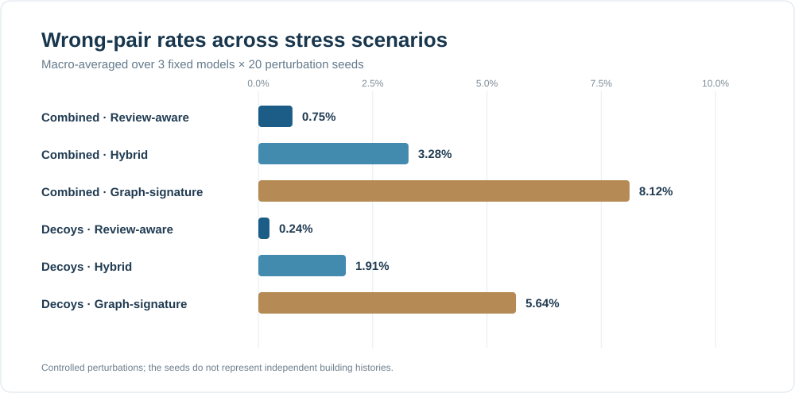
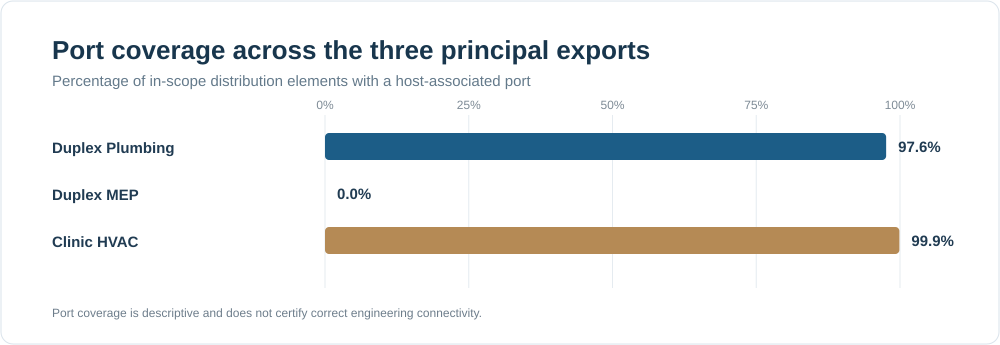

<div align="center">

# IT2 | IFC Revision Integrity

### Empirical Failure Analysis of Asset Correspondence and Network Topology

**Reproducible experiments · Controlled IFC revisions · Review-aware matching · Network adjacency checks**

[](README.md)
[](environment.yml)
[](LICENSE)
[](results/)
[](REPRODUCIBILITY.md)

**[Research question](#research-question) · [Key findings](#key-findings) · [Figures](#visual-results) · [Methods](#methodology) · [Mathematics](#mathematical-definitions-used-in-the-experiments) · [Paper evidence](PAPER_REPRODUCTION.md) · [Reproduce](#reproduce-the-study) · [Docker](#local-evidence-dashboard) · [Limitations](#scope-and-limitations)**

</div>

---

## Overview

**An IFC revision can appear almost unchanged in aggregate evaluation while the elements that matter most are not recovered, or the exported network has been rewired.**

This repository contains the research code, saved features, reported experimental outputs and supporting documentation for the conference manuscript:

> **Verifying Cross-Revision Referential Integrity in IFC Models: An Empirical Failure Analysis of Asset Correspondence and Network Topology**

IT2 examines two narrow **IFC-side** prerequisites for reliable cross-revision references: **correspondence of physical assets across exports** and **consistency of explicitly represented port-network adjacency**. It is **not** a validated digital twin, a live BMS integration, or a universal model-acceptance system.

The core contribution is a **failure analysis**, not a claim that IT2 always outperforms other matchers. We separate correct, wrong and unresolved matches, compare against relevant methods and demonstrate the blind spots of aggregate topology descriptors.

## Research question

> Can near-ceiling model-wide correspondence recall and stable aggregate network statistics conceal missed edited elements or changed exported adjacency between two IFC revisions?

The study asks:

- **RQ1, edited assets:** Can high overall correspondence recall hide failed recovery of the specifically changed assets?
- **RQ2, adjacency:** Can unchanged coverage and graph summaries hide altered port-to-port relationships?
- **RQ3, comparisons and uncertainty:** Which existing comparisons expose these failures, and when is the matching evidence insufficient?

## Key findings

| Evidence | Observed result | Interpretation |
|---|---:|---|
| External authored-edit benchmark | **36** revision pairs, **5** source-building identifiers | Additional authored cases, not 36 independent buildings |
| Review-aware aggregate recall | **97.90%** | High overall recall does not imply edited-target success |
| Edited targets recovered | **6 / 12** | Half of the labelled edits were unresolved or missed |
| Placement-only edited recovery | **8 / 12** | Higher target recovery came with **5** false creation links and **5** false deletion carry-forwards |
| Controlled plumbing graph | **498** elements, **485** edges, **20** components | Explicit exported topology, not physical ground truth |
| Network negative control | **20** rewiring trials | Adjacency changed while selected aggregate graph descriptors stayed unchanged |
| Identifier-regeneration comparison | IfcDiff **0%**, BIMDelta and IT2 **100%** in the reported controlled condition | Comparators answer different identity-matching tasks |
| Ambiguity, Duplex Plumbing | IT2 **88.2%** recall and **0%** wrong pairs; BIMDelta **98.3%** recall and **1.74%** wrong pairs | Rejection can trade recall for fewer wrong links |
| Ambiguity, Duplex MEP | IT2 **93.7%** recall and **0.32%** wrong pairs; BIMDelta **96.5%** recall and **0.14%** wrong pairs | **No claim of general superiority** |

**Sources:** [authored-edit summary](research/validation-2026-10-28/external_summary.json), [controlled comparison](results/contemporary_comparison.json), [ambiguity comparison](results/ambiguity_comparison.json), [topology records](results/topology.json), and [graph-stress results](results/comparator_full.json).

## Visual results

All six charts below are **generated from committed JSON evidence**, using [`scripts/generate_readme_charts.cjs`](scripts/generate_readme_charts.cjs). The chart-generation script reads the saved outputs directly; it does not run the experiments again.

### 1 · Overall matching accuracy can obscure edited-target failures


The overall recall denominator includes the largely unchanged model. The edited-target denominator includes the **12 labelled updates**. These percentages should not be interpreted as the same metric.


The placement baseline recovers more edited targets but incorrectly links creations and deletions. Abstention makes uncertainty explicit; it does not guarantee correct identity in every case.

### 2 · Contemporary-tool comparison under ambiguous revision conditions


In the tested Duplex MEP condition, BIMDelta attains **both** higher recall **and** fewer wrong pairs. Results are model-specific and must not be presented as overall IT2 superiority.

### 3 · Stress testing and network-readiness evidence



The stress comparison macro-averages three fixed model feature sets over 20 perturbation seeds, **not 60 independent buildings**. See [stress results](results/comparator_full.json).



Port coverage reports whether distribution elements have host-associated ports. It does **not** certify actual connectivity, hydraulic correctness, direction of flow, or operational asset binding.

### Historical figures and paper provenance

The [`figures/`](figures/) directory retains **historical original IT2 study figures** (workflow, design, topology quadrant, identity recall, sensitivity and roadmap). These were created for an earlier, broader manuscript; figure numbering and proposed-workflow scope **do not necessarily match the latest narrowed ISARC paper**. The SVGs above are the current evidence-focused README figures.

## Methodology

**S1 · Model readiness (partial).** Inspect exported host-associated ports and explicit port connections. Other requirements such as delivery-contract rules remain **proposed**.

**S2 · Cross-revision correspondence (implemented).** First consider retained GlobalIds subject to uniqueness/class checks; then exact (IFC class, Tag) and geometric one-to-one matching. The reported review-aware variant uses a **0.5 m** geometric gate and **0.03 m** competitive rejection margin. Ambiguous candidates may remain unresolved.

**S3 · IFC-side topology assessment (implemented).** Compute port coverage (PC), connection coverage (CC), largest component (LC), system membership (SM), and inspect mapped-edge disagreements across revisions. Aggregate descriptors are descriptive, **not** authoritative proof of identical adjacency.

**S4 · Final acceptance decision (proposed).** End-to-end acceptance and live asset-to-sensor validation were **not** experimentally validated.

### Experimental design and comparisons

- Principal experiments use feature records derived from **three MEP IFC exports** from two older public example projects, with controlled identifier regeneration, movement, decoys and rewiring.
- External authored-edit evaluation uses **36 BIM-Edit pairs** and **12 labelled update targets** across five source-building identifiers.
- Comparator evidence includes [IfcDiff and BIMDelta Core](results/contemporary_comparison.json), [ambiguity comparisons](results/ambiguity_comparison.json), and [Weisfeiler-Lehman-style signature variants](results/comparator_signature.json).
- **BIMdiff itself was not executed**, and the signature comparator is not presented as a reproduction of BIMdiff.

## Repository structure

```text
.
├── charts/                       # Six source-driven SVG figures for this README
├── scripts/                      # Original experiment and comparison scripts
│   ├── 01_topology.py
│   ├── 02_extract_features.py
│   ├── 03_identity.py
│   ├── 08_comparator_signature.py
│   ├── 09_stress_reconstruction.py
│   ├── 90_comparator_full.py
│   ├── 91_contemporary_comparison.py
│   ├── 92_ambiguity_comparison.py
│   ├── generate_readme_charts.cjs
│   └── reproduce_study.py
├── it2/                          # Supporting IFC topology and identity modules
├── data/
│   ├── download.py              # Upstream public dataset retrieval
│   └── features/                # Saved model feature JSON
├── research/validation-2026-10-28/
│                                 # Authored-edit summaries, hashes and provenance
├── results/                      # Saved JSON experimental outputs
├── figures/                      # Historical study figures; NOT revised paper figures
├── web/                          # Read-only local evidence dashboard
├── environment.yml               # Python environment
├── requirements-lock.txt         # Dependency snapshot
├── ARCHIVE_MANIFEST.sha256       # SHA-256 of original uploaded ZIP contents
├── REPRODUCIBILITY.md            # Bundled detailed historical reproduction guide
├── PAPER_REPRODUCTION.md         # Current ISARC tables, figures, and evidence map
├── Dockerfile / compose.yml      # Local dashboard (port 8674)
└── README.md
```


## Mathematical formulation of IT2

The following is the **equation-level specification of the implemented research methods**, with matching stages, optimization objectives, acceptance rules and evaluation metrics. The original hybrid and the review-aware extension are **distinct algorithms**. Full code and table provenance: [PAPER_REPRODUCTION.md](PAPER_REPRODUCTION.md).

### 1. Symbols and IFC graph construction

| Symbol | Definition |
|:---:|---|
| $X=\{x_i\}_{i=1}^{n}$, $Y=\{y_j\}_{j=1}^{m}$ | Earlier and revised IFC element sets |
| $g_i,t_i,q_i,k_i$ | GlobalId, Tag, type name, IFC class of an element |
| $s_i,\mathbf{c}_i,\mathbf{d}_i,\mathbf{p}_i$ | Spatial container, box centre, sorted box dimensions, placement origin |
| \(D,P,R\) | Distribution elements, exported ports, `IfcRelConnectsPorts` relations |
| \(H(p),h(p)\) | Set of host elements of port \(p\); its unique member when \(|H(p)|=1\) |
| \(M,T\) | Predicted pairs and reference-correct survivor pairs |

**Explicit-port adjacency** (undirected, uniquely owned endpoints):

**Equation (1)**

```math
E=\{\{h(p),h(q)\}:
(p,q)\in R,\; |H(p)|=|H(q)|=1,\;h(p)\neq h(q)\},\qquad G=(D,E).
```

Here $p(e)$ is the number of host-associated ports of element $e$; $d_Z(v)$ is the number of selected matching pairs incident to $v$.

**Coverage and graph descriptors**, with \(P_R=\{p:\exists q,\;(p,q)\in R\lor(q,p)\in R\}\), connected components \(C_1,\ldots,C_K\), and \(D_S\subseteq D\) belonging to a named system:

**Equation (2)**

```math
PC=\frac{\sum_{e\in D}\mathbf{1}[\,p(e)>0\,]}{|D|},
\quad
CC=\begin{cases}\frac{|P_R|}{|P|},&|P|>0,\\[2pt]0,&|P|=0,\end{cases}
```

**Equation (3)**

```math
LC=\frac{\max_{1\leq r\leq K}|C_r|}{|D|},
\qquad
SM=\frac{|D_S|}{|D|},
\qquad
K=|\mathrm{CC}(G)|.
```

For \(D=\varnothing\), the implementation raises an error. \(CC\) counts **ports in exported connection relations**, even if a relation is excluded from \(E\) because its host is ambiguous. Equations (1)–(3): [it2/graph.py](it2/graph.py), [it2/topology.py](it2/topology.py).

### 2. Original hybrid: Tag matching followed by Hungarian assignment

**Stage H1 — exact class–Tag keys** (as implemented for the original experimental hybrid):

**Equation (4)**

```math
M_{\mathrm{Tag}}=\{(i,j):k_i=k_j,\;t_i=t_j\neq\varnothing\}.
```

**Stage H2 — geometry cost**, within hard partitions \(k_i=k_j\) and \(s_i=s_j\):

**Equation (5)**

```math
C^{H}_{ij}
=\|\mathbf{c}_i-\mathbf{c}_j\|_2
+\|\mathbf{d}_i-\mathbf{d}_j\|_1
+\lambda\,\mathbf{1}[q_i\neq q_j],
\qquad \lambda=0.3.
```

For unmatched \(I=X\setminus\pi_X(M_{\mathrm{Tag}})\), \(J=Y\setminus\pi_Y(M_{\mathrm{Tag}})\), solve **separately in each class–container partition**:

**Equation (6)**

```math
Z_H^\star=\underset{z_{ij}\in\{0,1\}}{\arg\min}
\sum_{i\in I}\sum_{j\in J}C^H_{ij}z_{ij},
\quad
\sum_j z_{ij}\leq1,\quad\sum_i z_{ij}\leq1,
\quad \sum_{ij}z_{ij}=\min(|I|,|J|).
```

**Stage H3 — post-assignment distance gate**:

**Equation (7)**

```math
M_H=M_{\mathrm{Tag}}\;\cup\;\{(i,j):z^\star_{ij}=1,\;C^H_{ij}\leq\tau_H\},
\qquad\tau_H=0.5\,\mathrm{m}.
```

The original code applies the gate **after** Hungarian assignment; it is not a partial gated solver. The placement-only baseline replaces (5) with \(C^{P}_{ij}=\|\mathbf p_i-\mathbf p_j\|_2\) and uses \(\tau_P=1.0\,\mathrm m\). Equations (4)–(7): [it2/matching.py](it2/matching.py). Exact-key uniqueness is **not enforced by the historical original Tag baseline**.

### 3. Review-aware matcher: partial assignment and ambiguity rejection

**Stage R1 — unique class–Tag pairs passing the geometric plausibility gate:**

**Equation (8)**

```math
M_{\mathrm{key}}=\{(i,j):
\begin{array}{l}
(k_i,t_i)=(k_j,t_j),\;t_i\neq\varnothing,\\
\#_X(k_i,t_i)=\#_Y(k_j,t_j)=1,\\
\|\mathbf c_i-\mathbf c_j\|_2\leq0.5\,\mathrm m
\end{array}\}.
```

After removing those pairs, define the remaining element sets \(I,J\), partitioned **by IFC class** (container disagreement is penalized, not excluded).

**Stage R2 — review-aware cost:**

**Equation (9)**

```math
A_{ij}=\mathbf{1}[q_i\neq q_j]\,
\mathbf{1}[q_i\in Q_Y]\,
\mathbf{1}[q_j\in Q_X],
```

**Equation (10)**

```math
C^R_{ij}=
\|\mathbf c_i-\mathbf c_j\|_2
+0.1\min\{\sum_{a=1}^{3}|
\ln\max(d_{ia},10^{-3})-\ln\max(d_{ja},10^{-3})|,3\}
+0.15A_{ij}
+0.05\mathbf{1}[s_i\neq s_j].
```

**Stage R3 — feasible partial one-to-one matching.** Define \(\mathcal F=\{(i,j):k_i=k_j,\ C^R_{ij}\leq\tau_R\}\), \(\tau_R=0.5\,\mathrm m\). The implementation maximizes the number of valid pairs first, then minimizes their total cost. Here $n^\star$ is the largest possible number of non-overlapping feasible pairs:

**Equation (11)**

```math
Z_R^\star = \underset{Z\in\mathcal{Z}_{\max}}{\mathrm{argmin}}
\sum_{(i,j)\in Z}C^R_{ij},
\qquad
\mathcal{Z}_{\max} = \{Z\subseteq\mathcal{F}: |Z|=n^\star,\; d_Z(i)\leq 1,\;d_Z(j)\leq 1\}
```

**Stage R4 — confidence-by-competition rejection.** For a geometrically assigned \((i,j)\), compare its cost to all other candidates in its row and column of the **same class cost matrix**:

**Equation (12)**

```math
\Delta_{ij}=
\min\{\min_{k\neq j}C^R_{ik},\
\min_{\ell\neq i}C^R_{\ell j}\}-C^R_{ij},
\qquad \min\varnothing=+\infty.
```

**Equation (13)**

```math
M_R=M_{\mathrm{key}}\;\cup\;
\{(i,j)\in Z_R^\star:\Delta_{ij}>\max(0.03,10^{-12})\,\mathrm m\}.
```

The \(0.03\) m margin is a **fixed heuristic**, not a calibrated probability. The recorded BIM-Edit subset gives the same outcomes for the zero-margin and 0.03 m variants; it does not establish a separate improvement caused by the margin. Equations (8)–(13): [it2/review_matching.py](it2/review_matching.py) and the comparison driver [scripts/90_comparator_full.py](scripts/90_comparator_full.py).

**Operational ID stage (separate from identifier-masked simulation):**

**Equation (14)**

```math
M_{\mathrm{ID}}=\{(i,j):g_i=g_j\neq\varnothing,\;
k_i=k_j,\;
\#_X(g_i)=\#_Y(g_j)=1\}.
```

The operational pipeline may apply (14), then unique class–Tag matching, then review-aware geometry. **The controlled Tag-regeneration experiments do not use (14).** See [it2/checker.py](it2/checker.py).

### 4. Evaluation equations

For ground-truth surviving pairs \(T\), predicted pairs \(M\), \(TP=|M\cap T|\), and \(N=|T|\):

**Equation (15)**

```math
P=\frac{TP}{|M|},\qquad
R=\frac{TP}{N},\qquad
F_1=\frac{2PR}{P+R}.
```

**Equation (16)**

```math
W=\frac{|M|-TP}{N},\qquad
U=\frac{\bigl|\{(i,j)\in T:\nexists k,\;(k,j)\in M\}\bigr|}{N}.
```

**Equation (17)**

```math
\overline{x}_{\mathrm{macro}}
=\frac{1}{K}\sum_{r=1}^{K}x_r,
\qquad
CI_{95\%}(\overline{x})
=[Q_{0.025}(\overline{x}^{*}),\;
Q_{0.975}(\overline{x}^{*})].
```

Macro averages are **36 input/reference pairs** for Table 3 and **three fixed models × 20 seeds** for Table 6. The bootstrap resamples seed-level perturbation runs; these are not 60 independent buildings. Software convention in [it2/matching.py](it2/matching.py): empty predictions yield \(P=1\); for nonempty truth, \(R=0\). This is a reporting convention, not proof of perfect precision.

### 5. Cross-revision edge changes and structural signatures

Let \(f:D_{\mathrm{old}}'\to D_{\mathrm{new}}'\) be an accepted **one-to-one** element map and let \(E_o^f=\{\{f(u),f(v)\}:\{u,v\}\in E_o,\ u,v\in\mathrm{dom}(f)\}\), \(E_n^f=\{\{u,v\}\in E_n:u,v\in\mathrm{im}(f)\}\).

**Equation (18)**

```math
E_{\mathrm{retained}}=E_o^f\cap E_n^f,\qquad
E_{\mathrm{removed}}=E_o^f\setminus E_n^f,\qquad
E_{\mathrm{added}}=E_n^f\setminus E_o^f.
```

An edge with an unmatched endpoint is **unresolved**, not automatically deleted. These quantities compare exported adjacency, not physical network correctness: [it2/graph.py](it2/graph.py).

**Two-round Weisfeiler–Lehman structural signatures** (the constructed graph baseline, not BIMdiff):

**Equation (19)**

```math
s_v^{(0)}=k_v,\qquad
s_v^{(t+1)}
=H(s_v^{(t)}\Vert
\mathrm{sort}\{s_u^{(t)}:u\in N_G(v)\}),
\quad t\in\{0,1\}.
```

**Equation (20)**

```math
M_{\mathrm{struct}}=\{(i,j):s_i^{(2)}=s_j^{(2)},
\ |\{a:s_a^{(2)}=s_i^{(2)}\}|_X
=|\{b:s_b^{(2)}=s_j^{(2)}\}|_Y=1\}.
```

The signature-partitioned geometric variant instead assigns candidates **within equal-signature groups**, using centre distance and, for eligible group sizes, an additional dimension-difference term with a \(0.5\) m post-assignment gate. See [scripts/08_comparator_signature.py](scripts/08_comparator_signature.py) and [scripts/90_comparator_full.py](scripts/90_comparator_full.py).

---

## Reproduce the study

**Prerequisites:** Git, Python/Conda compatible with [`environment.yml`](environment.yml), and for regenerating README charts, Node.js. Source-model IFCs and BIM-Edit source content may require downloading from their respective upstream repositories.

```powershell
git clone https://github.com/Foysal-A-Al/it2-isarc2027-reproducibility.git
cd it2-isarc2027-reproducibility

# Create the documented Python environment:
conda env create -f environment.yml

# Consult environment.yml for the configured environment name, then activate it.
# To retrieve public study IFCs under their upstream license:
python data/download.py

# Inspect the original ZIP's recorded checksum manifest:
Get-Content ARCHIVE_MANIFEST.sha256

# Run the protected reproduction harness using its documented modes:
python scripts/reproduce_study.py --mode saved-features

# Regenerate the source-driven GitHub charts:
node scripts/generate_readme_charts.cjs
```

The **saved-features** mode checks downstream calculations against saved inputs; **raw-IFC** execution additionally depends on downloaded sources and the geometry toolchain. Historical [`REPRODUCIBILITY.md`](REPRODUCIBILITY.md) documents a broader previous study and figure numbering. **Hash verification and file availability have been checked, but a complete clean-environment rerun of every comparator has not been independently confirmed here.**

**Dataset and license provenance:** original public model files are available through [buildingSMART Sample-Test-Files](https://github.com/buildingSMART/Sample-Test-Files) and [buildingSMART Community-Sample-Test-Files](https://github.com/buildingsmart-community/Community-Sample-Test-Files). External authored-edit examples originate from the BIM-Edit benchmark, as cited in the manuscript. Raw third-party IFCs and external benchmark material are **not redistributed** by this repository. Respect the license terms of each upstream source.

## Local evidence dashboard

A lightweight **read-only** dashboard lets you inspect selected experiment outputs. It does not execute IFC revisions, accept uploads or provide a security-sensitive public data-processing endpoint.

```powershell
docker compose up -d --build
docker compose ps
# Open http://localhost:8674
```

The dedicated container uses `127.0.0.1:8674:8080`, non-root Nginx, a read-only filesystem and dropped Linux capabilities. This port is separate from the original IT2 application and does not require stopping existing containers.

## Scope and limitations

This is **a conference-scale empirical failure analysis**, not a comprehensive digital-twin validation framework.

1. **Age and independence:** principal IFCs come from older example projects; perturbation seeds do not create independent buildings.
2. **Truth labels:** the 12 authored-update labels are partial and not independently adjudicated operational asset bindings.
3. **Topology scope:** exported `IfcRelConnectsPorts` relations cannot establish intended, physical or hydraulically correct connections.
4. **Comparison scope:** the direct BIMdiff implementation was unavailable. BIMDelta, IfcDiff and reconstructed graph-signature methods are separate comparators.
5. **Operational scope:** no live BMS, IoT or sensor-to-asset linkage has been verified.

## Reproducibility and research integrity

- The original supplied ZIP's **42-entry inventory** and its `MANIFEST.sha256` were checked with **zero hash mismatches** before extraction.
- The original package scripts, saved JSON results and three feature datasets have been combined with the public repository's provenance records.
- `ARCHIVE_MANIFEST.sha256` covers the source ZIP's original files, **not the entire merged repository**. New figures are deterministic transformations of committed JSON.
- No independent full-paper validation or publication acceptance is claimed.
- The source project provides a [MIT software license](LICENSE); licenses and attribution for third-party datasets remain separate.

## Citation and academic use

The manuscript is intended as an ISARC 2027 submission. **No acceptance, DOI or publication status is asserted.** Please cite the final paper only once authoritative proceedings metadata becomes available. Until then, link to this repository and identify it as an unpublished research companion.

> **Repository:** [Foysal-A-Al/it2-isarc2027-reproducibility](https://github.com/Foysal-A-Al/it2-isarc2027-reproducibility)

---

<div align="center"><sub>IT2 research evidence · Correspondence, uncertainty and network adjacency across IFC revisions</sub></div>
